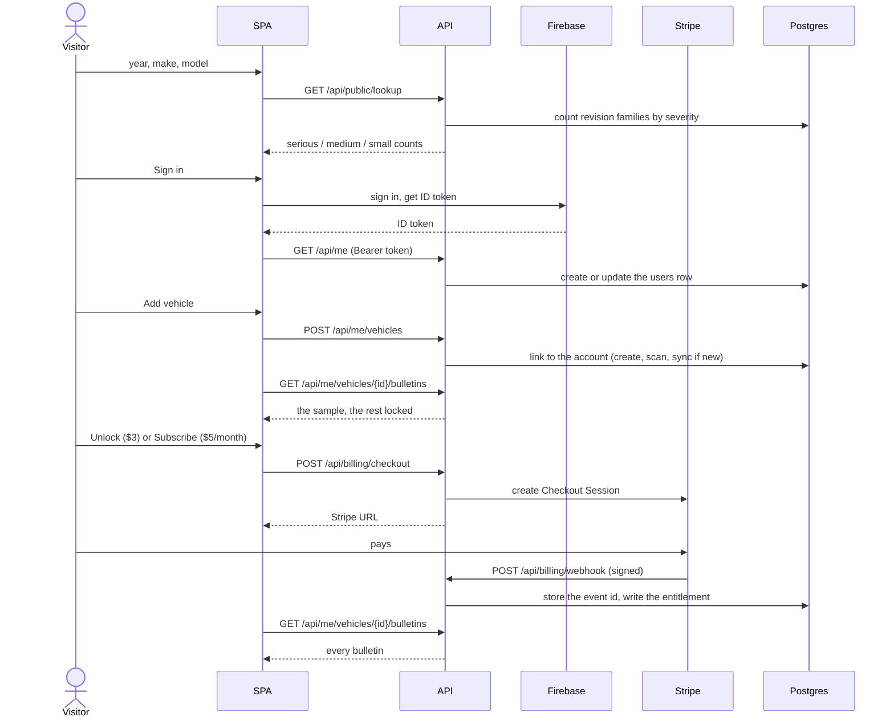

# The product

A visitor types a year, make and model and sees how many serious, medium and small
manufacturer communications NHTSA has filed for that car. To read them, they sign in, add
the car and either stay on the free sample or pay. Paid readers can also get a daily
email of new bulletins.

This page is for whoever runs or changes the product. Commands live in the
[pipeline runbook](pipeline-runbook.md); every environment variable lives in the
environment matrix in [deploy.md](deploy.md).

## The journey

A visitor looks up a car on the landing page with no account and sees three counts
(serious, medium, small) and whether the car is tracked. To read bulletins they sign in with
Firebase Authentication and add the car to their account (at most 10 cars). A free account
reads a sample of each car. Paying removes the sample limit: $3 once opens one car, $5 a
month opens every car on the account and adds daily email alerts. Stripe takes the payment
and tells the API through a signed webhook, which writes an entitlement; the page reads that
entitlement, so access follows the webhook, not the browser redirect.



## The sample rule

A free account, or any account with no entitlement for that car, reads the
**newest 1 serious, 2 medium, 3 small** bulletins of the car. "Newest" is by communication date, over
the whole list after revisions are folded into one row per bulletin family, and the quota is
applied per severity. Every other row is returned as a locked row: its severity and date are
visible, its content is not. A `search` on the bulletins endpoint never matches locked rows,
so searching cannot leak what is locked.

The legacy `/api/corpus/communications` list and detail endpoints bypass this rule, so they are admin-only; product pages read one bulletin through `GET /api/me/vehicles/{id}/bulletins/{nhtsa_id}`, which applies it. With full access that route also opens any other communication linked to the car (a superseded revision, or one still pending or failed), because symptom search can show the newest revision of a family whatever its status; under the sample rule only the folded list counts, and anything else is a 404.

Full access (`access_for` in the billing module) is granted when any of these is true: the
user is an admin; the user has an active subscription; the user has an active unlock for
that car. `past_due` and `canceled` entitlements grant nothing.

Symptom search needs full access to the car it searches, and is limited to 30 queries per
user per 24 hours. Admins are exempt from both.

## Pricing

| Plan | Price | Includes |
|------|-------|----------|
| Free account | $0 | The sample (1 serious, 2 medium, 3 small) of two different cars, ever |
| Unlock | $3, one time | Every bulletin and symptom search for one car, forever, including bulletins published later |
| Monthly | $5 per month | Every bulletin and symptom search for 2 cars at a time, and daily email alerts |
| All access | $20 per month | The same for 20 cars at a time |

Car limits (`_add_refusal` in `backend/src/me/service.py`): a subscriber may have as many
cars as the plan covers, not counting cars the account has unlocked; a car can be removed
and another added. A third (or twenty-first) add is a 402 that names the plan. Without a
subscription the free-sample rule applies and an account holds at most 10 cars. Both
subscriptions are `kind = 'subscription'` in `entitlements`; the `plan` column (`monthly`
or `all_access`) says which. An account holds one subscription: changing plan happens in
the Stripe Customer Portal, and `customer.subscription.updated` moves `plan` by the price id.

The prices are three Stripe Price ids (`STRIPE_PRICE_UNLOCK`, `STRIPE_PRICE_MONTHLY`,
`STRIPE_PRICE_ALL_ACCESS`). To
change an amount, create a new price (the `stripe_setup` command in the runbook creates the
three prices and reuses them by lookup key, so a changed amount needs a new lookup key in that
script) and set the new id. The webhook handles `checkout.session.completed`,
`checkout.session.async_payment_succeeded`, `customer.subscription.created`,
`customer.subscription.updated`, `customer.subscription.deleted` and `invoice.payment_failed`.
Events are idempotent by Stripe event id. A canceled subscription is never revived by a late
or retried event. Customers manage or cancel in the Stripe Customer Portal from the account
page.

## How severity is assigned

Every communication has one severity: serious, medium or small.

- **By type.** A fixed mapping from the NHTSA communication type. TSB, CSP and RC are
  serious; PIT, PIC, SB, TB, SU, WA and SC are medium; PIP, IB, BL, OL, DL, MC, NA and OTHER
  are small. An unknown or missing type is small.
- **Catch-all types.** MC, NA, OTHER and BL say little about the content, so a rule-based
  classifier reads the extracted document instead (recall is serious; an owner letter with a
  remedy is serious; a service procedure is medium; informational with symptoms and a remedy
  is medium; everything else small; a serious result from a dealer-facing document is capped
  at medium).

The mapping and the classifier are in `severity.py` in the communications module. To change
how a type is graded, edit the mapping there; the frontend uses the same tiers for its
colours (`COMM_PRIORITY_TYPES` in the client types).

## The prefill

The landing page is only useful for cars the system has already read, so a list of popular
cars is tracked and processed before launch. The list is `top50.json` in the seed module: a
JSON array of `{"year": 2020, "make": "FORD", "model": "F-150"}`, currently ten nameplates
across model years 2020 to 2024. JSON has no comments; to change the list, add or remove
entries (model as a person types it; the importer normalises it).

`python -m src.scripts.prefill` creates each vehicle, scans it, syncs its bulletins and
reads the documents through the Batch API under a spend cap (default $15). It is a dry run
unless `--apply` is given; the dry run prints an estimate. The apply prints what it spent,
measured from the `usage_events` ledger since the run began. To see the total yourself:

```sql
SELECT kind, count(*), sum(cost_usd) FROM usage_events
WHERE occurred_at > now() - interval '1 day' GROUP BY kind;
```

Exit code 3 means the cap was reached; running the same command again finishes the work,
because sync skips known bulletins and the stages only read documents not yet processed.

## Alerts

**Who gets them.** Users with an active subscription entitlement who have not
unsubscribed, plus every admin. Admins count as eligible whether or not they pay.

**What an alert lists.** Bulletins processed after the user's watermark, for the cars on the
account, grouped by car. Revisions are folded to the latest per bulletin family. A car whose
first processed bulletin is newer than the watermark appears under "Now ready" (the car was
added or finished processing since the last email).

**The watermark.** It is per user (`alert_state.last_watermark`) and advances only after a
successful send, so a failed send is retried in full on the next run, never skipped. A user
with no watermark yet starts from a baseline, never from the beginning of time: the moment
their earliest active subscription was created (`entitlements.created_at`). So a brand-new
subscriber's first email lists only news processed after they subscribed, and "Now ready"
names only cars whose first bulletin was processed after that moment. An admin with no
subscription has no such moment, so the first alert pass that sees them sends nothing and
stores that pass's time as their watermark; their first real alert carries only news after it.
On production this means the admin's own alerts start from the first pass after deploy (the
old single-recipient watermark is not carried across, because the `users` table is empty when
migration 0015 runs). A user with no news after their baseline gets no email and their
watermark stays where it was.

**Unsubscribe.** Every email carries a link to `/unsubscribe/{token}`, which calls the
public `GET /api/public/unsubscribe/{token}` (idempotent; an unknown token is a 404). A
subscriber can also turn alerts on or off in the Alerts card on `/app/account`
(`POST /api/me/alerts`); turning them on without a subscription (and not as an admin) is refused with 402.

**Running them.** The nightly pipeline's last stage sends alerts
(`python -m src.jobs.run_pipeline --send-digest`, alias `--send-alerts`). A single run, a
dry run, or one recipient: `python -m src.alerts` (see the runbook). `python -m src.jobs.digest`
is a shim that runs the alert pass for the admin only. `ALERT_TEST_RECIPIENT` redirects every
send to one address; use it on the replica only and leave it unset in production.

## The admin console

`/admin` is the original tracker dashboard: every tracked vehicle, add and remove, the
in-app refresh, and spend. It is only for admins: the SPA wraps it in an admin check and the
API rejects non-admins with 403 on the vehicle write routes, the refresh routes and
`GET /api/admin/usage`. Admins are the Firebase uids in `ADMIN_FIREBASE_UIDS`; a listed user
becomes an admin at their next sign-in.

## Environment

Which variable each service needs, and what to do with `READ_ONLY`, is in the
environment matrix in [deploy.md](deploy.md).
