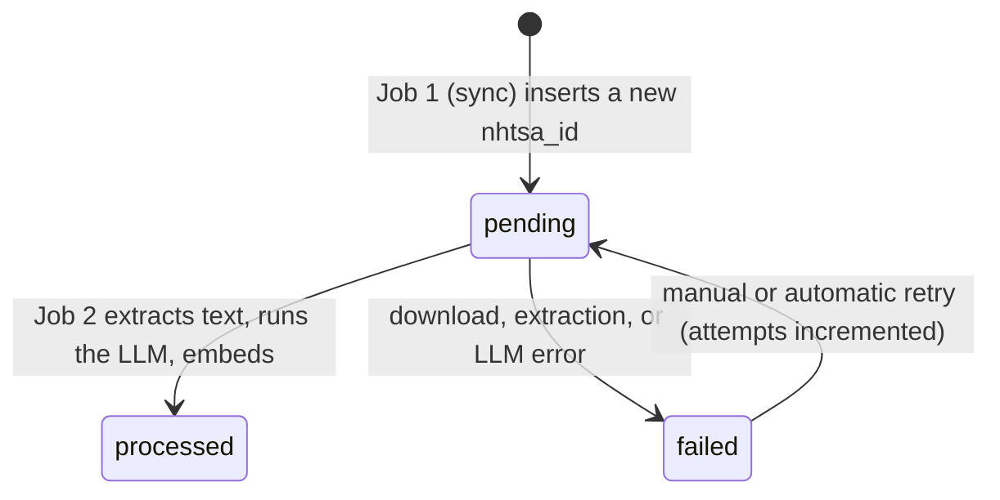

# Canonical Schema (Phase A)

This schema fixed the central flaw in the store that preceded it, where a
communication was upserted once per `(nhtsa_id, vehicle_id)` pair, so a bulletin
applying to three tracked vehicles was stored three times and would have been
extracted, summarised, and embedded three times. Here a communication exists
exactly once, keyed by `nhtsa_id`, and vehicles attach through a join table.

## ER diagram

```mermaid
erDiagram
    vehicles ||--o{ communication_vehicles : "tracked by"
    communications ||--o{ communication_vehicles : "applies to"
    communications ||--o{ comm_documents : "has PDFs"
    vehicles ||--o{ vehicle_bulletins : "scanned for"
    vehicles ||--o{ vehicle_scans : "ledger"
    flatfile_ingests ||..o{ comm_vocab : "source_window"

    vehicles {
        bigserial id PK
        integer nhtsa_vehicle_id "nullable legacy"
        integer year
        text make
        text model "canonical plain nameplate"
        text_array keywords
        boolean active
    }

    communications {
        bigserial id PK
        text nhtsa_id UK
        text communication_number
        text communication_type
        timestamptz communication_date
        text summary "NHTSA one-liner"
        text details_summary
        jsonb raw "full NHTSA payload"
        text status "pending|processed|failed"
        text status_reason
        integer attempts
        timestamptz processed_at
        tsvector search_tsv "generated"
    }

    comm_documents {
        bigserial id PK
        bigint communication_id FK
        text url UK
        text extracted_text
        text extraction_method "pymupdf|vision-fallback (yield flag)"
        integer page_count
        numeric chars_per_page
        numeric alpha_ratio
        text llm_summary
        text doc_kind "service_procedure|warranty_admin|recall|customer_letter|informational|other"
        text_array symptoms
        text_array systems
        text_array components
        text remedy
        text applicability
        numeric llm_cost_usd
        vector embedding "1536 dims"
        tsvector search_tsv "generated"
    }

    communication_vehicles {
        bigint communication_id PK_FK
        bigint vehicle_id PK_FK
        text_array matched_keywords
        timestamptz first_seen_at
    }

    comm_vocab {
        integer model_year PK "9999 = unknown"
        text make PK "uppercase, as published"
        text model PK "normalize_model form"
        text source_window PK "e.g. 2020-2024"
        integer bulletins "distinct nhtsa_ids for the triple in the window"
    }

    vehicle_bulletins {
        bigint vehicle_id PK_FK
        text nhtsa_id PK "joins communications.nhtsa_id by value, no FK"
        text summary "concise summary from the CSV"
        text source_window "window whose scan last wrote the row"
    }

    vehicle_scans {
        bigint vehicle_id PK_FK
        text source_window PK
        text etag "window etag the scan read"
        timestamptz scanned_at
    }

    flatfile_ingests {
        text source_window PK "1995-1999 ... 2025-2026"
        text etag "S3 ETag of the ingested zip"
        timestamptz last_modified
        integer row_count
        timestamptz ingested_at
    }
```

The flat-file index is lean: three small tables instead of a copy of NHTSA's catalogue.

- `comm_vocab` answers "what can the picker offer": one row per `(year, make, model,
  window)` with the number of distinct bulletins behind it (about 92k rows). Discovery
  reads it, and the counts let `flatfile.resolve_models` fold spelling variants and
  REDUNDANT/DUPLICATE copies of a nameplate.
- `vehicle_bulletins` answers "which bulletins belong to this tracked vehicle": filled by
  scanning the flat files for tracked identities only, with alias folding applied at scan
  time (variants of the vehicle's model all land on the one vehicle). Sync, the refresh
  preview and the identity check read it. `nhtsa_id` joins `communications.nhtsa_id` by
  value only; there is no foreign key, because a bulletin is listed here before (and
  independently of) the communication being fetched.
- `vehicle_scans` is the staleness ledger, one row per `(vehicle, window)` with the window
  etag the scan read. A pair is stale when its row is missing or `vehicle_scans.etag`
  differs from `flatfile_ingests.etag`; `flatfile.refresh_index` repairs stale pairs.
- `flatfile_ingests` is the ETag ledger, one row per source window, which makes the refresh
  idempotent: a window is re-ingested only when its ETag changed.

The database now grows with tracked vehicles, not with NHTSA: on the replica the index went
from 1,508 MB (`comm_products`) to about 12 MB (`comm_vocab` about 11 MB, `vehicle_bulletins`
under 1 MB for six vehicles). The downloaded zips live in a disk cache, not in Postgres (see
the [runbook](pipeline-runbook.md#flat-file-index)).

## Vehicle identity

A tracked vehicle is identified by `(year, make, model)`, and `vehicles.id` is the
one identifier everything uses, including `vehicleId` on the wire (API paths and
payloads). `nhtsa_vehicle_id` is nullable legacy data that nothing reads.

* **Canonical model form.** `vehicles.model` is stored the way
  `flatfile.normalize_model` writes it: uppercase, hyphen to space, whitespace
  collapsed. `F-150` is stored as `F 150`, and discovery lists the same strings.
* **Uniqueness.** `vehicles_active_identity_uidx` is a partial unique index on
  `(year, make, model) WHERE active`, so a soft-deleted vehicle may share an
  identity with a live one.
* **Reactivation.** Re-adding an identity that exists but is inactive revives that
  row (same `id`, links intact) instead of inserting a twin. Existing keywords are
  kept when the add supplies none. The partial index cannot be an `ON CONFLICT`
  target, so `upsert_vehicle` selects first and then updates or inserts.
* **Alias spellings.** NHTSA files some bulletins under junk or respelled model
  names (`F53` vs `F 53`, `REDUNDANT F 250`, `DUPLICATE ...`). Per `(model_year,
  make)`, `flatfile.resolve_models` folds those into one listed nameplate: spacing
  variants into the spelling with more bulletins, and a junk-prefixed name into its
  same-key sibling or, failing that, the one real name whose compact key starts or
  ends with it (`REDUNDANT F 250` into `F 250 SD`). Names it cannot resolve safely
  stay visible. Discovery lists the folded names only, and sync, refresh preview and
  `identity_check` match every alias spelling (`flatfile.model_aliases`), so no
  bulletin becomes unreachable.

## The job contract

`communications.status` is the only coupling between the two jobs.



Job 1 never touches documents; Job 2 never talks to the NHTSA API.
Either can be re-run independently without coordinating with the other.

## Design decisions

### Migration tooling: plain ordered SQL

Files live in `backend/migrations/NNNN_name.sql` and run in filename order via
`python -m src.db.migrate`. Applied versions are recorded in
`schema_migrations` with a checksum, so re-running is a no-op and editing an
already-applied migration is refused rather than silently ignored (which would
leave the file and the live database quietly out of sync).

Alembic was considered and rejected: it earns its complexity by autogenerating
diffs from ORM models, and there are no ORM models here. A solo project with a
linear schema history does not need the extra layer.

### Driver: asyncpg, no ORM

The pipeline and read API are hand-written SQL against Postgres-specific types
(`vector`, `tsvector`, `text[]`) that an ORM abstracts poorly. asyncpg is the
fastest driver and is what SQLAlchemy's async mode would sit on anyway.

### Embedding dimension: 1536, not 3072

`gemini-embedding-001` emits 3072 dimensions by default, but pgvector refuses to
build an `hnsw` or `ivfflat` index above **2000** dimensions:

```
ERROR:  column cannot have more than 2000 dimensions for hnsw index
```

The model supports Matryoshka (MRL) truncation, so requesting
`output_dimensionality=1536` yields a usable vector that indexes directly. The
alternative, storing `vector(3072)` and indexing a `halfvec` cast, adds a lossy
second representation for no benefit at this corpus size.

### Search vectors are generated columns, not triggers

`to_tsvector()` is IMMUTABLE, but `array_to_string()` and `concat_ws()` are only
STABLE, so neither can appear in a `GENERATED` expression. Rather than fall back
to a trigger, the schema defines a thin IMMUTABLE wrapper:

```sql
CREATE FUNCTION immutable_array_to_string(arr text[], sep text)
RETURNS text LANGUAGE sql IMMUTABLE PARALLEL SAFE AS
$$ SELECT array_to_string(arr, sep) $$;
```

This is safe because `text[]` output is fully deterministic, and it keeps the
search vector as a generated column, which cannot drift from its source rows the
way a trigger can if someone forgets to fire it.

Two separate vectors exist because a generated column may only reference its own
row: `communications.search_tsv` covers the NHTSA summary and bulletin number,
`comm_documents.search_tsv` covers the LLM fields and the extracted text. The
read API searches across both through the FK join.

### Extraction columns

`comm_documents.extraction_method` is `pymupdf` or `vision-fallback`. It is a yield
flag the input planner reads (usable local text or garbled text); there is no
separate vision path. `llm_model` holds the model that read the document:
`gemini-3.1-flash-lite`, `gemini-3.5-flash-lite` (history) or `claude-haiku-5-5`
(current). See [ADR 0002](adr/0002-haiku-pdf-direct-extraction.md).

### Tags: arrays plus GIN, not a tag table

`symptoms`, `systems`, and `components` are `text[]` with GIN indexes, giving
containment queries (`symptoms @> ARRAY['no start']`) without a join. A
normalised tag table would be the right call once tags need their own metadata
or user curation; that is a Phase B/C concern, not a Phase A one.

## Deliberately deferred to Phase C

The following are **not** in this schema, by design:

* **Users and authentication.** No `users` table, no ownership column anywhere.
  Phase A is single-tenant: the corpus is Marcus's, implicitly.
* **Per-user vehicle subscriptions.** `vehicles.active` is a personal on/off
  switch, not a subscription. Phase C introduces `users` and a
  `user_vehicles` (or equivalent) table, at which point `vehicles` becomes a
  shared catalog rather than a personal list.
* **Lazy ingest / per-user fan-out.** Phase A syncs every tracked vehicle
  eagerly. Phase C's lazy ingest needs request-time bookkeeping this schema does
  not model.
* **Alert delivery state.** The Phase A digest tracks a single watermark. Phase C
  needs per-user, per-channel delivery records for alerts and digests.

The join table is what makes that migration cheap: adding users means adding a
table beside `communication_vehicles`, not reshaping `communications`.

## Applying migrations

```bash
cd backend
python -m src.db.migrate            # apply pending
python -m src.db.migrate --status   # show applied / pending
```

Requires `DATABASE_URL` in `backend/.env` (see [database.md](database.md)).

### Migration history of note

| Migration | What it does |
|-----------|--------------|
| `0007` | Adds the flat-file index tables (`comm_products`, since replaced by 0013) and `flatfile_ingests` (additive) |
| `0008` | Relaxes `nhtsa_vehicle_id` (nullable, no unique), adds `vehicles_active_identity_uidx` |
| `0009` | Drops `vehicles.trim` and the retired YMM-to-vehicleId cache table |
| 0013 | Lean flat-file index: comm_vocab, vehicle_bulletins, vehicle_scans derived from comm_products, then comm_products dropped |

The data backfill to canonical models is a script
(`python -m src.scripts.backfill_plain_nameplate`), not a migration; see the
[runbook](pipeline-runbook.md#flat-file-index).
