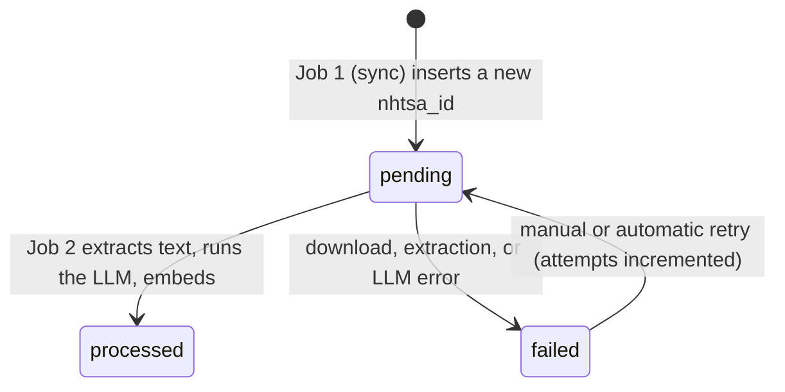

# Canonical Schema (Phase A)

This schema fixed the central flaw in the store that preceded it, where a
communication was upserted once per `(nhtsa_id, vehicle_id)` pair, so a bulletin
applying to three tracked vehicles was stored three times and would have been
extracted, summarised, and embedded three times. Here a communication exists
exactly once, keyed by `nhtsa_id`, and vehicles attach through a join table.

## ER diagram

```mermaid
erDiagram
    vehicles ||--o{ communication_vehicles : "tracked by"
    communications ||--o{ communication_vehicles : "applies to"
    communications ||--o{ comm_documents : "has PDFs"
    vehicles ||--o{ vehicle_bulletins : "scanned for"
    vehicles ||--o{ vehicle_scans : "ledger"
    flatfile_ingests ||..o{ comm_vocab : "source_window"
    users ||--o{ user_vehicles : "tracks"
    vehicles ||--o{ user_vehicles : "tracked by"
    users ||--o{ entitlements : "owns"
    vehicles |o--o{ entitlements : "unlocks (unlock only)"
    users ||--o| alert_state : "alert settings"

    vehicles {
        bigserial id PK
        integer nhtsa_vehicle_id "nullable legacy"
        integer year
        text make
        text model "canonical plain nameplate"
        text_array keywords
        boolean active
        timestamptz first_synced_at "null until the first full sync"
        timestamptz ready_at "null until the first read finished"
    }

    communications {
        bigserial id PK
        text nhtsa_id UK
        text communication_number
        text communication_type
        timestamptz communication_date
        text summary "NHTSA one-liner"
        text details_summary
        jsonb raw "full NHTSA payload"
        text status "pending|processed|failed"
        text status_reason
        integer attempts
        timestamptz processed_at
        tsvector search_tsv "generated"
    }

    comm_documents {
        bigserial id PK
        bigint communication_id FK
        text url UK
        text extracted_text
        text extraction_method "pymupdf|vision-fallback (yield flag)"
        integer page_count
        numeric chars_per_page
        numeric alpha_ratio
        text llm_summary
        text doc_kind "service_procedure|warranty_admin|recall|customer_letter|informational|other"
        text_array symptoms
        text_array systems
        text_array components
        text remedy
        text applicability
        numeric llm_cost_usd
        vector embedding "1536 dims"
        tsvector search_tsv "generated"
    }

    communication_vehicles {
        bigint communication_id PK_FK
        bigint vehicle_id PK_FK
        text_array matched_keywords
        timestamptz first_seen_at
        boolean alert_pending "news not yet mailed"
    }

    comm_vocab {
        integer model_year PK "9999 = unknown"
        text make PK "uppercase, as published"
        text model PK "normalize_model form"
        text source_window PK "e.g. 2020-2024"
        integer bulletins "distinct nhtsa_ids for the triple in the window"
    }

    vehicle_bulletins {
        bigint vehicle_id PK_FK
        text nhtsa_id PK "joins communications.nhtsa_id by value, no FK"
        text summary "concise summary from the CSV"
        text source_window "window whose scan last wrote the row"
    }

    vehicle_scans {
        bigint vehicle_id PK_FK
        text source_window PK
        text etag "window etag the scan read"
        timestamptz scanned_at
    }

    flatfile_ingests {
        text source_window PK "1995-1999 ... 2025-2026"
        text etag "S3 ETag of the ingested zip"
        timestamptz last_modified
        integer row_count
        timestamptz ingested_at
    }

    users {
        bigserial id PK
        text firebase_uid UK
        text email
        text display_name
        boolean is_admin
        timestamptz last_seen_at
    }

    user_vehicles {
        bigint user_id PK_FK
        bigint vehicle_id PK_FK
        timestamptz created_at
    }

    entitlements {
        bigserial id PK
        bigint user_id FK
        text kind "unlock|subscription"
        text plan "monthly|all_access, null for an unlock (0019)"
        bigint vehicle_id FK "null for a subscription"
        text status "active|canceled|past_due"
        text stripe_customer_id
        text stripe_checkout_session_id UK
        text stripe_subscription_id UK
        timestamptz current_period_end
    }

    stripe_events {
        text event_id PK
        text type
        timestamptz received_at
    }

    alert_state {
        bigint user_id PK_FK
        timestamptz last_watermark
        timestamptz last_sent_at
        timestamptz unsubscribed_at
        text unsubscribe_token UK
    }
```

The flat-file index is lean: three small tables instead of a copy of NHTSA's catalogue.

- `comm_vocab` answers "what can the picker offer": one row per `(year, make, model,
  window)` with the number of distinct bulletins behind it (about 92k rows). Discovery
  reads it, and the counts let `flatfile.resolve_models` fold spelling variants and
  REDUNDANT/DUPLICATE copies of a nameplate.
- `vehicle_bulletins` answers "which bulletins belong to this tracked vehicle": filled by
  scanning the flat files for tracked identities only, with alias folding applied at scan
  time (variants of the vehicle's model all land on the one vehicle). Sync, the refresh
  preview and the identity check read it. `nhtsa_id` joins `communications.nhtsa_id` by
  value only; there is no foreign key, because a bulletin is listed here before (and
  independently of) the communication being fetched.
- `vehicle_scans` is the staleness ledger, one row per `(vehicle, window)` with the window
  etag the scan read. A pair is stale when its row is missing or `vehicle_scans.etag`
  differs from `flatfile_ingests.etag`; `flatfile.refresh_index` repairs stale pairs.
- `flatfile_ingests` is the ETag ledger, one row per source window, which makes the refresh
  idempotent: a window is re-ingested only when its ETag changed.

The database now grows with tracked vehicles, not with NHTSA: on the replica the index went
from 1,508 MB (`comm_products`) to about 12 MB right after the migration (three windows
ingested), and to about 30 MB once all eight windows are bootstrapped (`comm_vocab` 28 MB,
`vehicle_bulletins` 1.6 MB for six vehicles). The downloaded zips live in a disk cache, not in Postgres (see
the [runbook](pipeline-runbook.md#flat-file-index)).

## Vehicle identity

A tracked vehicle is identified by `(year, make, model)`, and `vehicles.id` is the
one identifier everything uses, including `vehicleId` on the wire (API paths and
payloads). `nhtsa_vehicle_id` is nullable legacy data that nothing reads.

* **Canonical model form.** `vehicles.model` is stored the way
  `flatfile.normalize_model` writes it: uppercase, hyphen to space, whitespace
  collapsed. `F-150` is stored as `F 150`, and discovery lists the same strings.
* **Uniqueness.** `vehicles_active_identity_uidx` is a partial unique index on
  `(year, make, model) WHERE active`, so a soft-deleted vehicle may share an
  identity with a live one.
* **Reactivation.** Re-adding an identity that exists but is inactive revives that
  row (same `id`, links intact) instead of inserting a twin. Existing keywords are
  kept when the add supplies none. The partial index cannot be an `ON CONFLICT`
  target, so `upsert_vehicle` selects first and then updates or inserts.
* **Alias spellings.** NHTSA files some bulletins under junk or respelled model
  names (`F53` vs `F 53`, `REDUNDANT F 250`, `DUPLICATE ...`). Per `(model_year,
  make)`, `flatfile.resolve_models` folds those into one listed nameplate: spacing
  variants into the spelling with more bulletins, and a junk-prefixed name into its
  same-key sibling or, failing that, the one real name whose compact key starts or
  ends with it (`REDUNDANT F 250` into `F 250 SD`). Names it cannot resolve safely
  stay visible. Discovery lists the folded names only, and sync, refresh preview and
  `identity_check` match every alias spelling (`flatfile.model_aliases`), so no
  bulletin becomes unreachable.

## The job contract

`communications.status` is the only coupling between the two jobs.



Job 1 never touches documents; Job 2 never talks to the NHTSA API.
Either can be re-run independently without coordinating with the other.

## Design decisions

### Migration tooling: plain ordered SQL

Files live in `backend/migrations/NNNN_name.sql` and run in filename order via
`python -m src.db.migrate`. Applied versions are recorded in
`schema_migrations` with a checksum, so re-running is a no-op and editing an
already-applied migration is refused rather than silently ignored (which would
leave the file and the live database quietly out of sync).

Alembic was considered and rejected: it earns its complexity by autogenerating
diffs from ORM models, and there are no ORM models here. A solo project with a
linear schema history does not need the extra layer.

### Driver: asyncpg, no ORM

The pipeline and read API are hand-written SQL against Postgres-specific types
(`vector`, `tsvector`, `text[]`) that an ORM abstracts poorly. asyncpg is the
fastest driver and is what SQLAlchemy's async mode would sit on anyway.

### Embedding dimension: 1536, not 3072

`gemini-embedding-001` emits 3072 dimensions by default, but pgvector refuses to
build an `hnsw` or `ivfflat` index above **2000** dimensions:

```
ERROR:  column cannot have more than 2000 dimensions for hnsw index
```

The model supports Matryoshka (MRL) truncation, so requesting
`output_dimensionality=1536` yields a usable vector that indexes directly. The
alternative, storing `vector(3072)` and indexing a `halfvec` cast, adds a lossy
second representation for no benefit at this corpus size.

### Search vectors are generated columns, not triggers

`to_tsvector()` is IMMUTABLE, but `array_to_string()` and `concat_ws()` are only
STABLE, so neither can appear in a `GENERATED` expression. Rather than fall back
to a trigger, the schema defines a thin IMMUTABLE wrapper:

```sql
CREATE FUNCTION immutable_array_to_string(arr text[], sep text)
RETURNS text LANGUAGE sql IMMUTABLE PARALLEL SAFE AS
$$ SELECT array_to_string(arr, sep) $$;
```

This is safe because `text[]` output is fully deterministic, and it keeps the
search vector as a generated column, which cannot drift from its source rows the
way a trigger can if someone forgets to fire it.

Two separate vectors exist because a generated column may only reference its own
row: `communications.search_tsv` covers the NHTSA summary and bulletin number,
`comm_documents.search_tsv` covers the LLM fields and the extracted text. The
read API searches across both through the FK join.

### Extraction columns

`comm_documents.extraction_method` is `pymupdf` or `vision-fallback`. It is a yield
flag the input planner reads (usable local text or garbled text); there is no
separate vision path. `llm_model` holds the model that read the document:
`gemini-3.1-flash-lite`, `gemini-3.5-flash-lite` (history) or `claude-haiku-5-5`
(current). See [ADR 0002](adr/0002-haiku-pdf-direct-extraction.md).

### Tags: arrays plus GIN, not a tag table

`symptoms`, `systems`, and `components` are `text[]` with GIN indexes, giving
containment queries (`symptoms @> ARRAY['no start']`) without a join. A
normalised tag table would be the right call once tags need their own metadata
or user curation; that is a Phase B/C concern, not a Phase A one.

## Accounts, billing and alerts (migration 0014)

Five tables sit beside the corpus. None of them changes `communications`,
`comm_documents` or `vehicles`. Together they answer who may see what and who gets mailed.

- `users` is one row per Firebase account, created at first sign-in and keyed by
  `firebase_uid`. `is_admin` is set at sign-in when the uid is listed in
  `ADMIN_FIREBASE_UIDS`; admins see everything and are exempt from the symptom-search limit.
- `user_vehicles` is the account's saved cars, a join to the shared `vehicles` catalog. An
  account holds at most 10; the API enforces it, the table does not. Removing a car deletes
  only this link, never the vehicle or its bulletins.
- `entitlements` holds what a user paid for. `kind = 'unlock'` carries a `vehicle_id` and
  opens that one car; `kind = 'subscription'` has a null `vehicle_id` and opens every car on
  the account, and its `plan` (`monthly` 2 cars, `all_access` 20 cars) sets how many cars the
  account may hold. Only `status = 'active'` grants anything: `past_due` and `canceled` rows are
  kept for history and the account page. The two Stripe id columns are unique, so a webhook
  replay cannot create a second row for the same checkout or subscription.
- `stripe_events` records every Stripe event id the webhook has handled. An id seen once is
  acknowledged and never processed again.
- `alert_state` is one row per alert recipient (every account with a car, since 0022):
  `last_watermark` (the newest moment already mailed), `last_sent_at`, `unsubscribed_at` and a random
  `unsubscribe_token` that goes into the link in every email. A user with no watermark yet
  starts from the time their subscription began (an admin with no subscription is baselined,
  silently, on the first sending pass), so a first email never replays a car's history. Rows
  are created the first time the alert run sees the user as a recipient.
- `bulletin_reads` (migration 0016) is one row per (user, `nhtsa_id`) the user has read,
  keyed on the latest revision of a family so a new revision arrives unread; it drives
  the `unread` and `newThisWeek` counts on `GET /api/me`.
- `sample_grants` (migration 0018) is one row per (user, vehicle) the account was ever
  given a free sample of. A free account may hold two that are not covered by an active
  unlock; a removed car keeps its row, so removing and adding hands out no new sample.
  Subscribers and admins are not limited.
- `vehicle_removals` (migration 0020) is one row per car a subscriber took off a plan. A
  plan covers N cars at a time, so the count of this month's rows is what stops a subscriber
  from reading any number of cars by swapping (`PLAN_REMOVALS`: Monthly 1, All access 5 per
  calendar month, UTC). Removing an unlocked car, or any car on an account without a
  subscription, writes no row. The same migration adds `user_vehicles.alerts_enabled` (leave
  one car out of the alert email) and `entitlements.cancel_at_period_end` (a cancelled
  subscription that still runs to the end of its period).
- `ingest_queue` (migration 0017) is the list of cars waiting to be read after a user added
  them: one row per vehicle, oldest first, with `attempts` and `last_error`. A background
  worker inside the API (`src/refresh/queue.py`) reads them one at a time and stops when the
  list is empty; it starts again on the next add or the next start of the API. A read that
  fails three times stays in the table and is left to the nightly run.

## Batch jobs out at Anthropic (migration 0023)

`llm_batches` is one row per Batch API job the pipeline submitted, with `collected_at` null
until its results are stored. A batch is paid for when Anthropic finishes it, collected or
not. The nightly run waits an hour for its batch; before this table, one that took longer
was forgotten and the next night sent, and paid for, the same documents again, with the
first batch's cost never reaching `usage_events` or the daily cap. Now `process.run_llm`
collects every open row first and submits nothing new while one is still running.

## New-bulletin flag (migration 0021)

`vehicles.first_synced_at` is when a car's first complete sync finished (the car already
scanned, no cap, and every scanned bulletin fetched; a bulletin NHTSA lists but never serves
stops holding it back once the car's oldest link is 3 days old, `FIRST_SYNC_GIVE_UP_DAYS`). A link sync creates after that moment gets
`communication_vehicles.alert_pending = true`; a link created before it is the car's history
and stays false. The alert pass mails pending, processed links to the car's subscribers and
sets them back to false. The partial index `communication_vehicles_alert_pending_idx` covers
only the waiting rows.

## Ready marker and free recipients (migration 0022)

`vehicles.ready_at` is when a car's first read finished: its first sync is done and no
bulletin linked to it is still `pending`. A sending alert pass stamps it once
(`mark_ready_vehicles`); accounts whose baseline is older get the ready email. Cars already
fully read when the migration ran were given the time of their first processed bulletin.
The migration also gives every existing account an `alert_state` row starting at the moment
it ran, because free accounts are alert recipients from here on.

## Alerts (migration 0015)

0015 carries the admin's old single-recipient watermark into `alert_state` (only when an
admin user and the old row both exist) and drops the old table. Re-running it is a no-op.

Historical note: the Phase A watermark table `digest_state` was replaced by `alert_state` in
0015.

## Added by the product project

The items below were listed here as deferred to a later phase. They shipped on
2026-11-07 (milestones M1 to M5 of the product project); see [product.md](product.md) for
how they behave.

| Was deferred | Now (all 2026-11-07) | Where |
|--------------|-----|-------|
| Users and authentication | `users`, Firebase sign-in, admin flag (M1) | 0014 |
| Per-user vehicle subscriptions | `user_vehicles`; `vehicles` is a shared catalog and `active` is no longer a personal switch for accounts | 0014 |
| Lazy ingest | A car added by an account that is new to the catalog is created, scanned and synced on demand (M3) | API, no schema |
| Alert delivery state | Per-user `alert_state` (M5) | 0014, 0015 |
| Payments | `entitlements` and `stripe_events` (M4) | 0014 |

Still not modelled: per-channel delivery records (email is the only channel) and a
history of sent alerts; `alert_state` keeps only the latest send.

## Applying migrations

```bash
cd backend
python -m src.db.migrate            # apply pending
python -m src.db.migrate --status   # show applied / pending
```

Requires `DATABASE_URL` in `backend/.env` (see [database.md](database.md)).

### Migration history of note

| Migration | What it does |
|-----------|--------------|
| `0007` | Adds the flat-file index tables (`comm_products`, since replaced by 0013) and `flatfile_ingests` (additive) |
| `0008` | Relaxes `nhtsa_vehicle_id` (nullable, no unique), adds `vehicles_active_identity_uidx` |
| `0009` | Drops `vehicles.trim` and the retired YMM-to-vehicleId cache table |
| 0013 | Lean flat-file index: comm_vocab, vehicle_bulletins, vehicle_scans derived from comm_products, then comm_products dropped |
| 0014 | Accounts: `users`, `user_vehicles`, `entitlements`, `stripe_events`, `alert_state` |
| 0015 | Alerts: moves the admin watermark into `alert_state`, drops the old digest watermark table |
| 0023 | `llm_batches`: Batch API jobs still out, so none is paid for twice |
| 0022 | Ready and free alerts: `vehicles.ready_at`, and an `alert_state` row for every existing account |
| 0021 | Alerts list new bulletins only: `vehicles.first_synced_at` (set for cars already synced) and `communication_vehicles.alert_pending` with a partial index |

The data backfill to canonical models is a script
(`python -m src.scripts.backfill_plain_nameplate`), not a migration; see the
[runbook](pipeline-runbook.md#flat-file-index).
